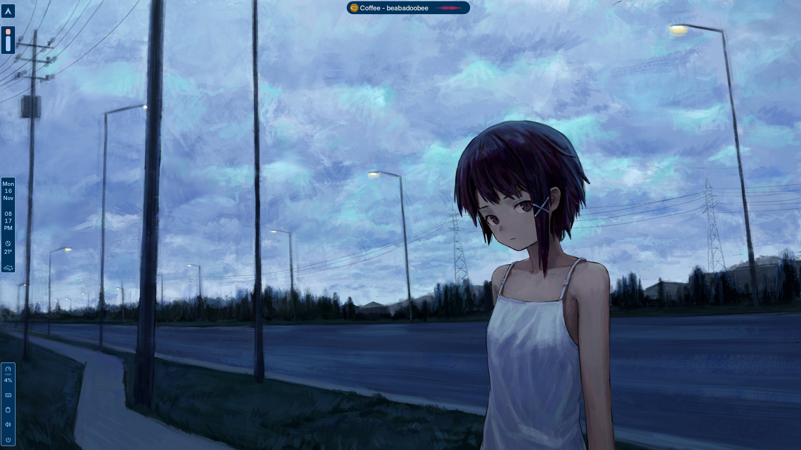
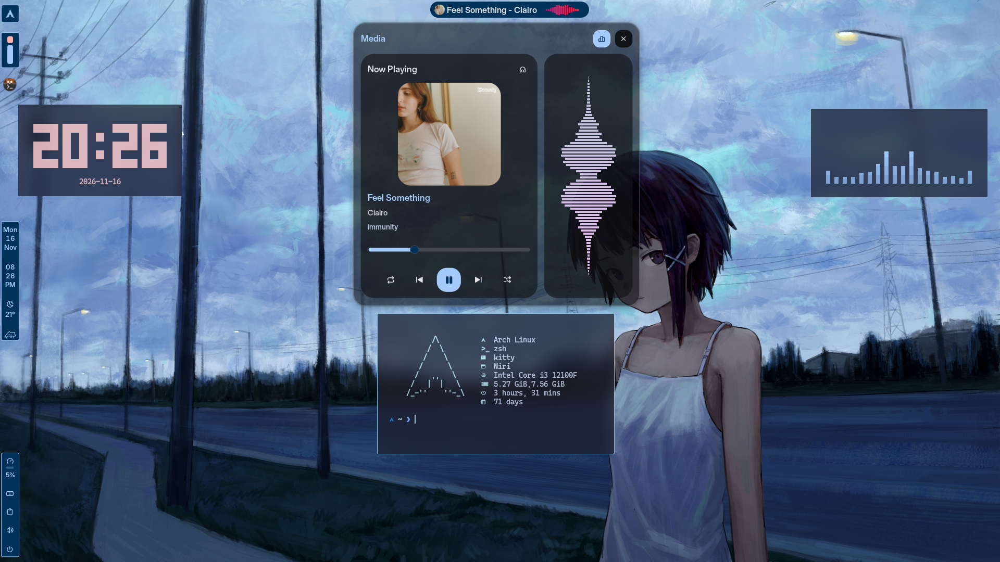
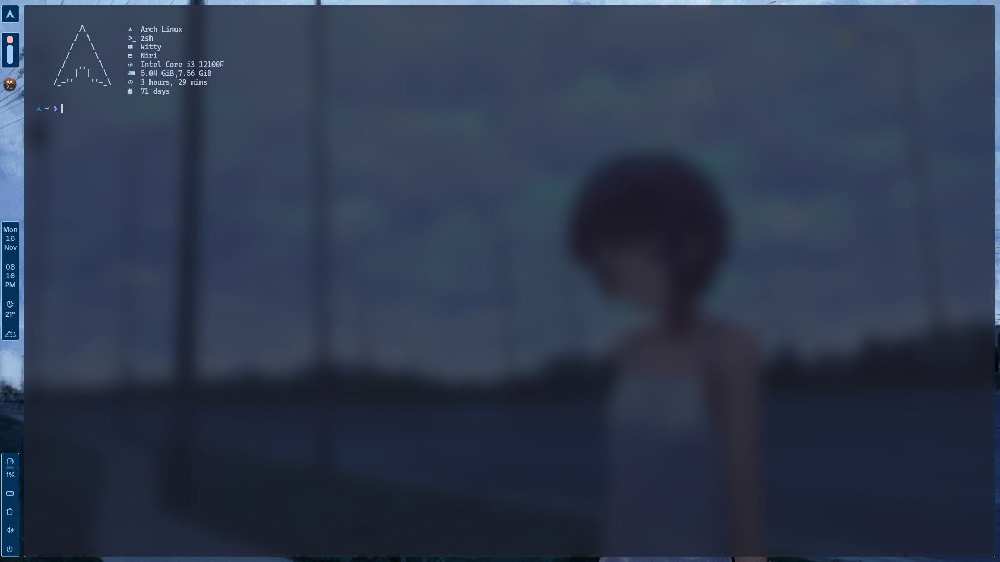
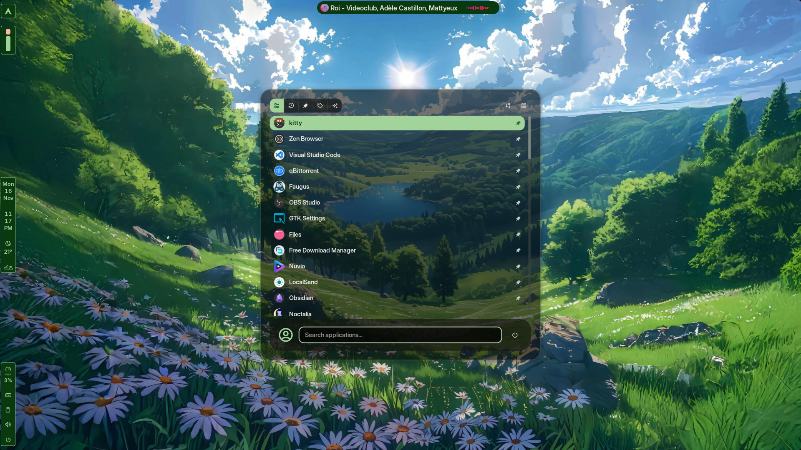

# Dots

My Linux desktop configuration files, featuring **Niri** and **Noctalia**.

It contains my configurations, customizations, desktop setup, and some wallpapers that I use. The goal is to maintain a clean, functional, and visually consistent Wayland environment.

Feel free to explore, use, or adapt anything you find useful.

> The Noctalia files target **v5**. They will **not** work with Noctalia v4 (see [Noctalia](#noctalia-v550)).

## Preview

| Desktop                                                                                                                             | Terminal                                                 |
| ----------------------------------------------------------------------------------------------------------------------------------- | -------------------------------------------------------- |
| [](screenshots/desktop.png) [](screenshots/desktop2.png) | [](screenshots/kitty.png) |

## Components

| Component                                               | Description                                    |
| ------------------------------------------------------- | ---------------------------------------------- |
| [Niri](https://github.com/niri-wm/niri)                 | Scrollable-tiling Wayland compositor           |
| [Noctalia](https://github.com/noctalia-dev/noctalia)    | Desktop shell and graphical interface (v5.5.0) |
| [Fastfetch](https://github.com/fastfetch-cli/fastfetch) | System information tool                        |
| [Kitty](https://github.com/kovidgoyal/kitty)            | GPU-accelerated terminal emulator              |

## Repository Structure

```
dots/
├── fastfetch/
├── kitty/
├── niri/
│   └── cfg/
├── noctalia/
├── screenshots/
├── wallpapers/
├── install.sh
└── README.md
```

| Directory / File | Description                                           |
| ---------------- | ----------------------------------------------------- |
| `fastfetch/`     | Fastfetch configuration                               |
| `kitty/`         | Kitty terminal configuration and themes               |
| `niri/`          | Niri configuration, split into modular KDL files      |
| `niri/cfg/`      | Individual Niri configuration modules                 |
| `noctalia/`      | Noctalia settings (`settings.toml`)                   |
| `screenshots/`   | Desktop and terminal screenshots                      |
| `wallpapers/`    | Wallpapers used in the setup                          |
| `install.sh`     | Installer: backs up your configs, then installs these |
| `README.md`      | Repository documentation                              |

## Requirements

Install these **before** running the installer:

| What                                               | Why                                                                                               |
| -------------------------------------------------- | ------------------------------------------------------------------------------------------------- |
| `git`, `niri`, `kitty`, `fastfetch`                | The configured applications                                                                       |
| `nautilus`                                         | `Mod + E` opens it (change the keybind if you use another file manager)                           |
| A browser                                          | `Mod + B` opens Zen Browser by default (change it in `niri/cfg/keybinds.kdl`)                     |
| `xwayland-satellite`                               | Niri uses it to run X11 apps (many games and older apps)                                          |
| **Noctalia v5.5.0**                                | The desktop shell. Install it from the [official docs](https://docs.noctalia.dev)                 |
| **Inter Nerd Font**                                | Font used by Noctalia (`Inter Nerd Font Propo Display SemiBold`) #available through the AUR only! |
| CaskaydiaCove Nerd Font Mono in `kitty/kitty.conf` | Terminal font and icons                                                                           |
| 3 Noctalia plugins                                 | `ishan0121/wallpaper-deck`, `kenn/keybind-cheatsheet`, `noctalia/bongocat`                        |

On Arch-based systems the regular packages can be installed with:

```
sudo pacman -Syu --needed git niri kitty fastfetch nautilus ttf-cascadia-code-nerd xwayland-satellite
```

> `-Syu` also updates your whole system. That is the correct way to install packages on Arch, but you should know it happens.

Fonts and Noctalia itself are not in that command on purpose: package names differ between distributions, so check the Noctalia docs and your package manager (for example `pacman -Ss inter nerd`).

## Installation

### 1. Clone the repository

```
git clone https://github.com/Nexzz1/dots.git
cd dots
```

### 2. Read before you run

Dotfiles can replace your existing setup. Look through the files first, especially `install.sh`.

### 3. Run the installer

```
chmod +x install.sh
./install.sh
```

What the script does:

1. Asks for confirmation (skip with --yes).
2. Prepares everything in a temporary folder first: it copies the configs and replaces the **HOME** placeholder in noctalia/settings.toml with your real home directory. If anything goes wrong here, your current configs are not touched.
3. Backs up your existing configs automatically. Any existing ~/.config/fastfetch, ~/.config/kitty, ~/.config/niri and ~/.config/noctalia are moved (not deleted) to ~/.config/dots-backup/<date-time>/.
4. Puts the new configs in ~/.config/

It refuses to run as root, so don't use sudo. Running it again is safe: every run gets its own backup folder.

Options:

| Option         | Effect                                                                                    |
| -------------- | ----------------------------------------------------------------------------------------- |
| `--yes`, `-y`  | Skip the confirmation prompt                                                              |
| `--wallpapers` | Also copy `wallpapers/` to `~/Pictures/Wallpapers` (existing files are never overwritten) |

### 4. Finish the Noctalia setup

Install the three plugins and fonts from the [requirements](#requirements), then check that Noctalia accepts the config:

```
noctalia config validate
```

### 5. Apply changes

Log out and back in, or restart the relevant applications.

### Restoring your old configs

Your old configs are in `~/.config/dots-backup/`. To put one back (example for niri):

```
rm -rf ~/.config/niri
mv ~/.config/dots-backup/<date-time>/niri ~/.config/niri
```

## Noctalia (v5.5.0)

Everything about the desktop shell (bar, dock, launcher, lock screen, session menu, theme, wallpapers) lives in `noctalia/settings.toml`.

### Version

These files are for **Noctalia v5.5.0** (`config_version = 20`). Noctalia v5 is a separate, fresh install from the older Quickshell-based v4 line. The config formats are different (v5 uses TOML), and settings are not migrated between them. Don't mix their instructions.

### How the config is loaded

Noctalia v5 reads settings in layers:

1. Built-in defaults
2. Your `*.toml` files in `~/.config/noctalia/` (this repository installs `settings.toml` there)
3. Settings you change in the Noctalia GUI, saved in `~/.local/state/noctalia/settings.toml`. These load last and **win** over the file from this repository.

So if you install this and a value seems ignored, check `~/.local/state/noctalia/settings.toml`. Deleting that file clears your GUI overrides. See the [Noctalia configuration docs](https://docs.noctalia.dev/noctalia/configuration/).

### The `__HOME__` placeholder

Paths in `settings.toml` look like `__HOME__/Pictures/Wallpapers/...`. This keeps my username out of the repository. `install.sh` replaces `__HOME__` with your home directory. If you copy the file by hand, run:

```
sed -i "s|__HOME__|$HOME|g" ~/.config/noctalia/settings.toml
```

### What is specific to my hardware and system

Change these to match your machine:

| Setting                                                          | What it is                                                                                                                 | What to do                                                    |
| ---------------------------------------------------------------- | -------------------------------------------------------------------------------------------------------------------------- | ------------------------------------------------------------- |
| `HDMI-A-1`                                                       | My monitor's name. Used by the lock screen widgets (`lockscreen_widgets`) and `[wallpaper.monitors.HDMI-A-1]`              | Run `niri msg outputs` to find yours and rename it            |
| `placement_width = 1920` / `placement_height = 1080`, `cx`, `cy` | Lock screen widget positions, laid out for a 1920×1080 screen                                                              | Reposition for your resolution (easiest in Noctalia Settings) |
| `ui_scale`, bar `scale` / `thickness`, dock `icon_size`          | Sizes tuned for my screen                                                                                                  | Adjust to taste                                               |
| `fingerprint = false`                                            | Assumes no fingerprint reader                                                                                              | Change if you have one                                        |
| `minimum_brightness`                                             | Only matters on screens with a controllable backlight                                                                      | Ignore on most desktops                                       |
| `pinned` apps in `[dock]` and `[shell.launcher]`                 | My apps (Zen, VS Code, Faugus, OBS, qBittorrent, Obsidian, and others)                                                     | Replace with your own                                         |
| `font_family`                                                    | `Inter Nerd Font Propo Display SemiBold`                                                                                   | Install it, or choose another font                            |
| Personal image paths                                             | Lock screen sticker, launcher icon, wallpaper paths. The sticker and launcher icon are **not** included in this repository | Provide your own images or remove those lines                 |

Niri has hardware-specific lines too: the monitor mode (resolution@refresh rate) in `niri/config.kdl` and `niri/cfg/display.kdl`. Run `niri msg outputs` to see the modes your monitor supports.

### Plugins

`settings.toml` enables these plugins, and the bar uses two of them (`bongocat` and `keybind-cheatsheet`). They are not stored in this repository, so install them through Noctalia first, otherwise those widgets won't show:

- `ishan0121/wallpaper-deck`
- `kenn/keybind-cheatsheet`
- `noctalia/bongocat`

### Theming

Noctalia is set to generate colors from the wallpaper (`source = "wallpaper"`) and to apply them to other apps: alacritty, btop, cava, emacs, GTK 3/4, KDE color schemes, kitty, niri, Qt, scroll and starship (`[theme.templates]`). Changing the wallpaper can therefore change the colors of those apps too.

## Keybindings

`Mod` refers to the **Super (Windows) key**.

### Applications & Noctalia

| Keybind               | Action                                      |
| --------------------- | ------------------------------------------- |
| `Mod + Enter`         | Open Kitty terminal                         |
| `Mod + B`             | Open Zen Browser (see note below)           |
| `Mod + E`             | Open Nautilus file manager (see note below) |
| `Mod + Ctrl + Enter`  | Open Noctalia App Launcher                  |
| `Mod + S`             | Open Noctalia Control Center                |
| `Mod + Shift + Enter` | Open Noctalia Wallpaper Selector            |
| `Mod + Shift + S`     | Open Noctalia Settings                      |
| `Mod + Alt + L`       | Lock Screen                                 |
| `Mod + Shift + Q`     | Open Session Menu                           |

> **Note:** `Mod + B` and `Mod + E` launch Zen Browser and Nautilus. Change them in `niri/cfg/keybinds.kdl` if you use a different browser or file manager.

### Window Management & Navigation

| Keybind                      | Action                       |
| ---------------------------- | ---------------------------- |
| `Mod + Q`                    | Close focused window         |
| `Mod + H / J / K / L`        | Navigate between windows     |
| `Mod + Ctrl + H / J / K / L` | Move windows                 |
| `Mod + 1–9`                  | Switch workspaces            |
| `Mod + Tab`                  | Switch to previous workspace |
| `Mod + Space`                | Toggle Overview              |

### Additional Controls

| Keybind            | Action               |
| ------------------ | -------------------- |
| `Mod + F`          | Maximize column      |
| `Mod + Shift + F`  | Toggle fullscreen    |
| `Mod + T`          | Toggle floating mode |
| `Ctrl + Shift + 2` | Take Screenshot      |

For the complete list of keybindings, check [`niri/cfg/keybinds.kdl`](niri/cfg/keybinds.kdl).

## Customization

Each application has its own folder, so you can change one component without touching the others.

Some settings are specific to my hardware, display, installed applications or distribution. The full list for Noctalia is [above](#what-is-specific-to-my-hardware-and-system). For Niri, check the monitor mode lines mentioned there.

## Wallpapers

The wallpapers I use are in [`wallpapers/`](wallpapers). Use `./install.sh --wallpapers` to copy them to `~/Pictures/Wallpapers`, which is where `settings.toml` looks for them.

Noctalia supports dynamic theming, so the desktop's color palette adapts to the currently selected wallpaper. This keeps the snnl, panels, and other UI elements visually consistent with the background.

[](screenshots/example.png)

## Notes

- Installing the dotfiles does **not** install the required software. See [Requirements](#requirements).
- Always review the configurations before applying them.
- Some adjustments may be necessary depending on your system.

## Credits

All credit goes to the developers and contributors behind the projects used in this setup.

- [Niri](https://github.com/niri-wm/niri)
- [Noctalia](https://github.com/noctalia-dev/noctalia)
- [Fastfetch](https://github.com/fastfetch-cli/fastfetch)
- [Kitty](https://github.com/kovidgoyal/kitty)
- Noctalia plugins: `ishan0121/wallpaper-deck`, `kenn/keybind-cheatsheet`, `noctalia/bongocat`
